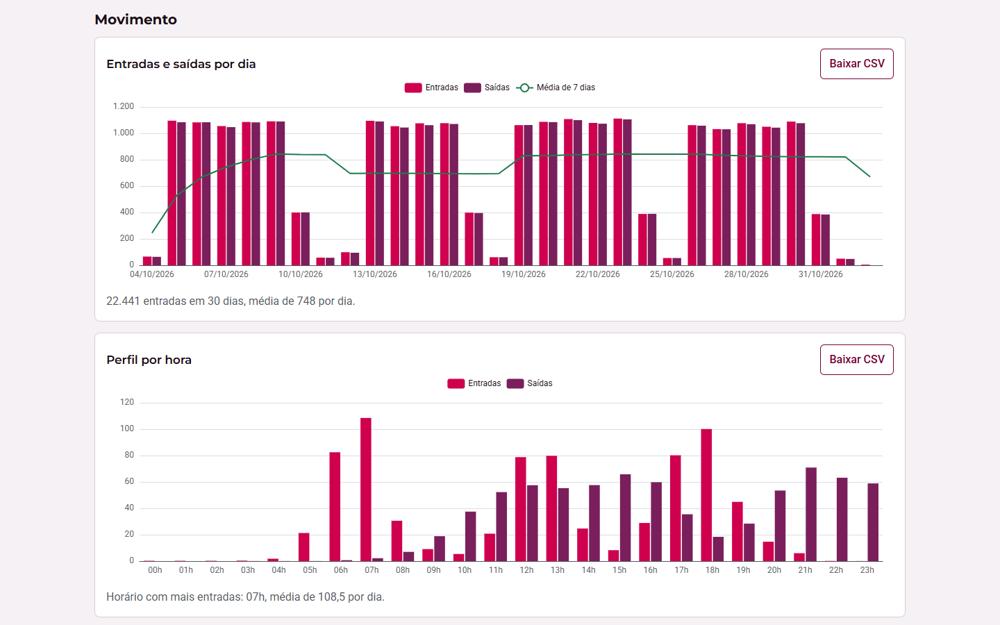
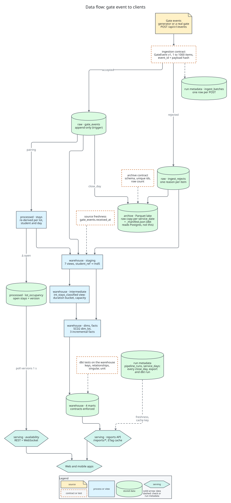
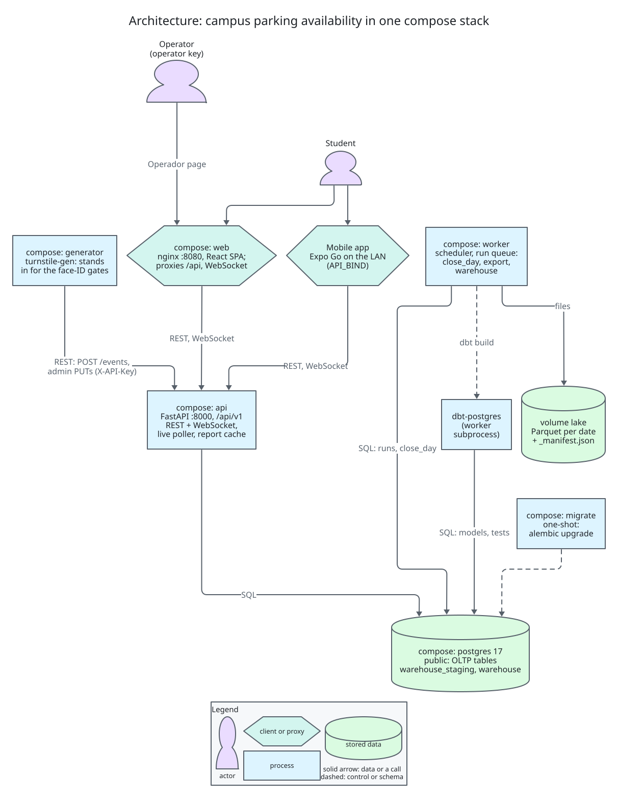
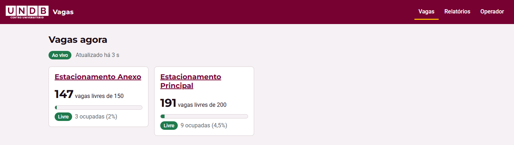
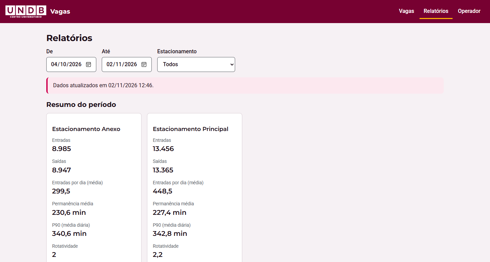
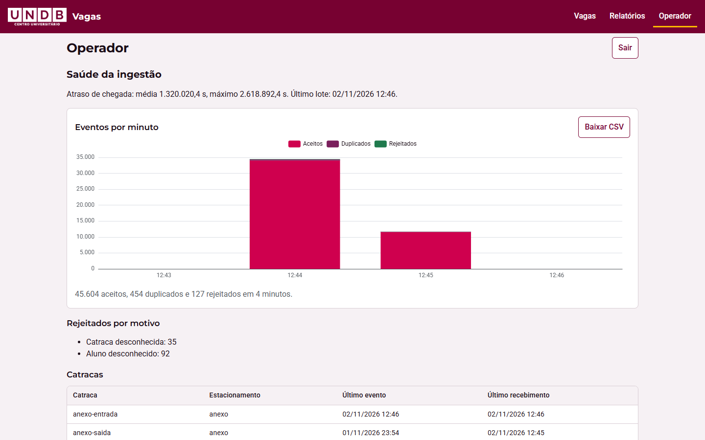
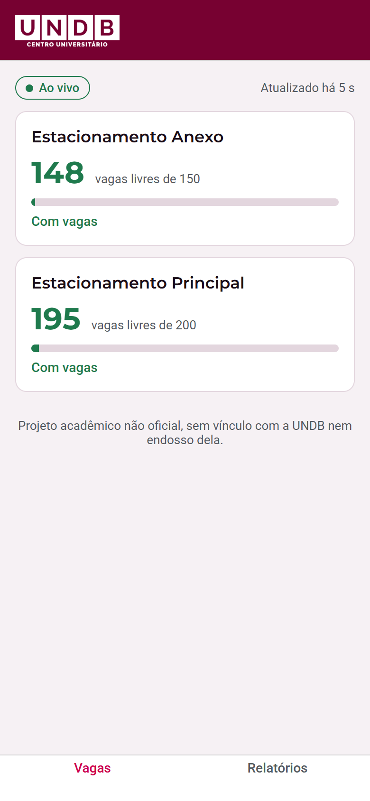
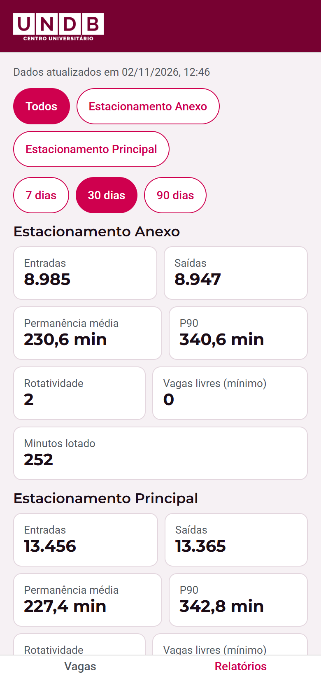

# UNDB Campus Parking

> Campus parking availability built from simulated turnstile events (a rebuilt UNDB course
> project): an idempotent ingestion API, an incremental occupancy counter pushed over WebSocket,
> a nightly Parquet archive and a dbt warehouse behind the reports of a web app and an Expo
> mobile app.

[](https://github.com/emanuel-luis/undb-campus-parking/actions/workflows/ci.yml)
[](https://github.com/emanuel-luis/undb-campus-parking/actions/workflows/security.yml)

Unofficial academic project, not affiliated with or endorsed by UNDB.



The Relatórios (reports) page of the web app after a 30-day demo run.

## What this demonstrates

- **An idempotent ingestion contract.** `POST /api/v1/events` takes batches of 1 to 1000
  versioned `GateEvent` items. The event id plus a payload hash makes a resend a duplicate and a
  conflicting resend a reject; every bad item is stored with a reason (unknown gate or student,
  lot or direction mismatch, too old, in the future), and busy or draining servers answer 429 or
  503 with `Retry-After`.
- **Incremental occupancy without full scans.** Each batch re-derives the stays of only the
  (lot, student, day) it touched and applies the change in open stays to a per-lot counter with a
  version. The result does not depend on arrival order or duplicates; Hypothesis property tests
  check that, and a one-second version poll pushes full snapshots over WebSocket.
- **Reconciliation with run metadata.** A worker with a Postgres-backed run queue
  (`FOR UPDATE SKIP LOCKED`) closes each past day: open stays are closed at local midnight, the
  counter is recounted and drift recorded. Every run lands in `pipeline_runs`, closed days in
  `service_days`, and late events reopen a day for the next run.
- **A Parquet archive with contract checks.** Each closed day is exported per service date, with
  events and rejects checked against the archive contract (schema, unique ids, row count) and
  published with a `_manifest.json` through an atomic directory swap, so a rerun is safe.
- **A dbt star schema with tests and freshness.** dbt-postgres builds staging views, an
  intermediate view, an SCD2 lot dimension, three incremental facts and four marts with enforced
  contracts, plus relationships, singular and unit tests and source freshness. CI builds it twice
  and checks the marts did not change.
- **Typed clients from one OpenAPI contract.** `backend/openapi.json` is generated from the app
  and drift-checked; the generator's Pydantic models and the TypeScript client shared by web and
  mobile are generated from it and drift-checked too.

## Quickstart

Needs Docker with Compose v2.24 or newer, GNU Make, Bash and Python 3 (on Windows, run it from
WSL). Details and troubleshooting are in [docs/running.md](docs/running.md).

```bash
git clone https://github.com/emanuel-luis/undb-campus-parking && cd undb-campus-parking
make demo                         # 90 days of history (DEMO_BACKFILL_DAYS)
```

Or, for a faster first run:

```bash
make demo DEMO_BACKFILL_DAYS=7
```

Then check REST and the live WebSocket through nginx with `make smoke`.

`make demo` writes random API keys to `.env` (never printed), builds and starts the stack,
backfills the history through the API and runs the daily job once, so the reports have data.
Measured on a 30-day run: the backfill posted 46,178 events (45,597 accepted, 454 duplicates and
127 injected rejects) in about 74 seconds, and the daily run that followed closed the 30 days and
rebuilt the warehouse in about 43 seconds. The default 90 days takes longer.

| What | Where |
| --- | --- |
| Web app | http://localhost:8080 (`WEB_PORT`) |
| API and its docs | http://localhost:8000/docs (`API_PORT`) |
| Operator key (Operador page) | `grep PARKING_OPERATOR_API_KEY .env` |

`make demo-down` stops everything and deletes the volumes.

## Data flow

Gate events arrive through one contract, become an append-only log and a live counter, and are
then archived and modeled for the reports.



| Layer | Objects | Guarantees |
| --- | --- | --- |
| Source | the generator (or a real gate) posting `POST /api/v1/events` | API keys per role, batch limits, backpressure with `Retry-After` |
| Contract | `GateEvent` v1 (`ingestion/contract.py`) | Frozen schema, event-time bounds (120 days back, 300 s ahead), a reason for every reject |
| Raw | `gate_events`, `ingest_rejects`, `ingest_batches` | Append-only events (trigger), dedupe on `event_id` + payload hash |
| Processed | `stays`, `lot_occupancy` | Re-derived per lot, student and day; exact counter with a version |
| Warehouse | `warehouse_staging` views (staging, `int_stays_classified`); `warehouse` dimensions, facts and marts | Built by dbt from Postgres; tests, source freshness, enforced mart contracts |
| Serving | `/api/v1/availability`, `/api/v1/live/availability`, `/api/v1/reports/*` | Full snapshots over WebSocket; reports cached per warehouse run with ETag |
| Archive (side output) | `raw/gate_events/`, `raw/ingest_rejects/` Parquet per date | Raw lake copy; dbt reads Postgres. Contract check before publishing, manifest with row count and hashes, atomic swap |
| Run metadata | `pipeline_runs`, `service_days` | One row per job run; closed days; report freshness |



Click a diagram to open it at full size. D2 sources:
[data-flow.d2](docs/diagrams/data-flow.d2), [architecture.d2](docs/diagrams/architecture.d2)
(all of them are in [docs/diagrams/](docs/diagrams/)).

- The three user flows (a car passing a gate, a student checking a lot, the daily run) are drawn
  next to their steps in [docs/flow.md](docs/flow.md).
- The three ERDs (OLTP tables, warehouse dimensions and facts, marts) are next to their tables in
  [docs/data-model.md](docs/data-model.md).

## Screenshots

From a local `make demo` run with a 30-day backfill.







The Operador page counts every batch in its window. Its very high arrival lag is the backfill
posting 30 days of past events in a few minutes, not a live delay, and its 45,604 accepted events
are the 45,597 from the backfill plus the live traffic that arrived after it.

<table>
  <tr>
    <td></td>
    <td></td>
  </tr>
</table>

## Origin

This started in 2024 as the project of a mobile-programming course at UNDB (Centro Universitário
Dom Bosco). The face-ID turnstiles at the campus lots record every car that enters or leaves, so
the question was simple: how many spaces are free right now? I wrote the backend; a teammate
wrote a mobile front-end that is not in this repository. The 2024 backend was two FastAPI
services: a turnstile simulator that wrote Faker data to Parquet files, and a parking API that
pulled everything from the simulator over HTTP on every request and paired entries with exits in
pandas.

In 2026 I rebuilt it as a small data system, keeping the UNDB identity and the original idea.
The two services became one backend and a separate event generator; Parquet became the archive
instead of the database; and the counts now come from an append-only event log, maintained
incrementally and pushed to the clients as they change. The events are still simulated: nothing
here reads real UNDB data. The design is in [docs/REFACTOR_PLAN.md](docs/REFACTOR_PLAN.md) and
every choice is logged in [docs/DECISIONS.md](docs/DECISIONS.md).

## Web and mobile

Both apps are in pt-BR and use the UNDB colors, logo and fonts ([docs/BRAND.md](docs/BRAND.md)).
They share one TypeScript client generated from the OpenAPI contract, including the live socket
logic.

- **Web** (`apps/web`, React + Vite): Vagas (live lots), a lot page with the day's occupancy,
  Relatórios (KPI cards, daily and hourly charts, weekday comparison, dwell time, data quality,
  CSV download) and Operador (ingestion health, rejects by reason, gates, run history; asks for
  the operator key). Served by nginx in `make demo`; `make web-dev` runs Vite on port 5173.
- **Mobile** (`apps/mobile`, Expo SDK 57): Vagas, lot detail and Relatórios, running in Expo Go.
  The phone talks to the API directly, so expose the API on the LAN (`API_BIND=0.0.0.0`) and
  start Expo with `EXPO_PUBLIC_API_BASE_URL=http://<LAN-IP>:8000 make mobile-start`. The steps,
  including the firewall, are in [docs/running.md](docs/running.md#expo-go-on-a-phone-lan).

## Backend and generator

The repository holds two Python projects that share nothing but the contract.

- **`backend/`** (`campus-parking`): one FastAPI app, one `/api/v1` surface, one Alembic history
  and one image, run as `api` (uvicorn), `worker` (scheduler, run queue, close_day, export, dbt)
  and the one-shot `migrate`. The dbt project lives in `backend/warehouse/`. Routers, services and
  repositories are split per feature: `registry`, `ingestion`, `occupancy`, `realtime`, `jobs`,
  `reports`.
- **`generator/`** (`turnstile-gen`): the stand-in for the face-ID turnstile system of the
  original project. It has no database access and no backend imports; it is an API client with
  Pydantic models generated from `backend/openapi.json`. `bootstrap` creates the lots, gates and
  10,000 pseudonymous students through the admin endpoints, `backfill --days N` posts past days
  with weekday, rush-hour and holiday patterns and injected faults, and `run` streams live events.
  Event ids are uuid5 of the event content, so a rerun is all duplicates.

A real gate integration would replace the generator and use the same endpoint and ingest key.

## Tech stack

- Backend: Python 3.12 · FastAPI · SQLAlchemy 2 (async) · Alembic · Pydantic · pyarrow ·
  Prometheus client
- Data: Postgres 17 · dbt-postgres · Parquet
- Generator: Python 3.12 · httpx · Pydantic models generated with datamodel-code-generator
- Clients: TypeScript · React 19 · Vite · React Router · TanStack Query · ECharts · Expo SDK 57
  (React Native, Expo Router) · openapi-typescript
- Quality: uv · ruff · mypy · pytest · Hypothesis · ESLint · Vitest · Jest
- Delivery: Docker Compose · nginx · GitHub Actions · Dependabot · D2

## Development

Python work needs uv; the JS workspace needs Node 24 (`.nvmrc`). `make help` lists every target.

```bash
make install                  # backend (with the dbt group) and generator environments
make js-install               # npm ci for apps/web, apps/mobile and packages/api-client
make lint                     # ruff, mypy, eslint, tsc and the three drift checks (= CI)
make test                     # pytest with 85% coverage gates, Vitest, Jest, web build, Expo export
make up-db                    # start the compose Postgres, then:
make test-integration         # Postgres integration tests
make openapi                  # regenerate backend/openapi.json from the app
make gen-generator-models     # regenerate the generator's Pydantic models from it
make api-client               # regenerate packages/api-client/src/schema.ts from it
make warehouse                # incremental dbt build as a recorded run (needs PARKING_DATABASE_URL)
make warehouse-full           # source freshness and a full-refresh build as a recorded run
make d2-install               # once: the pinned D2 v0.9.0 (Linux x86_64, sha256 checked)
make diagrams                 # render docs/diagrams/*.d2 to SVG
make diagrams-check           # render and fail on any difference (the CI diagrams job)
make diagrams-watch NAME=architecture  # live preview of one diagram
```

On Windows, run the diagram targets in WSL: CI renders with the Linux binary and the committed
SVGs must match it byte for byte.

CI, in `.github/workflows/ci.yml`:

- backend lint (ruff, mypy, OpenAPI drift) and tests with the coverage gate;
- backend integration tests against a Postgres service container;
- the JS workspace: lint, typecheck, tests, web build, Expo export and the client drift check;
- generator lint (with the models drift check) and tests;
- end to end: the real API on Postgres, a 7-day backfill twice, the daily run, an incremental dbt
  build that must leave the marts unchanged, and `dbt test`;
- compose smoke: `make demo` and `scripts/smoke.py` through nginx;
- `diagrams`: the committed SVGs must match the D2 sources.

`security.yml` runs pip-audit, npm audit and zizmor. Dependabot proposes monthly minor and patch
updates.

## Project structure

```
backend/
  src/campus_parking/   core, registry, ingestion, occupancy, realtime, jobs, reports; main.py, cli.py
  alembic/versions/     0001_registry, 0002_ingestion_occupancy, 0003_jobs
  warehouse/            dbt project: staging, intermediate, marts, seeds, tests
  openapi.json          the committed API contract
generator/src/turnstile_generator/   bootstrap, backfill, live, sender; api_models.py is generated
packages/api-client/    generated schema.ts, fetch client, live socket helper, React Query keys
apps/web/               React + Vite app and its nginx image
apps/mobile/            Expo Router app for Expo Go
scripts/                smoke.py, e2e_check.py, warehouse_check.py (CI checks)
docs/                   decisions, plan, flow, API notes, data model, running, brand, diagrams
compose.yaml  Makefile  .env.example
```

## Documentation

- [docs/flow.md](docs/flow.md): the whole flow in one ordered sequence, with the user-flow diagrams.
- [docs/data-model.md](docs/data-model.md): tables, models, grains and incremental rules, with the ERDs.
- [docs/running.md](docs/running.md): running the stack, keys, Expo Go on a phone.
- [docs/api.md](docs/api.md): the live WebSocket protocol and client rules.
- [docs/DECISIONS.md](docs/DECISIONS.md): the decision log.
- [docs/REFACTOR_PLAN.md](docs/REFACTOR_PLAN.md): the rebuild plan.
- [docs/BRAND.md](docs/BRAND.md): visual identity sources and contrast checks.
- [CHANGELOG.md](CHANGELOG.md).

## License

[MIT](LICENSE). The UNDB name, logo and colors belong to UNDB and are used only to place this
academic project; see [docs/BRAND.md](docs/BRAND.md).
