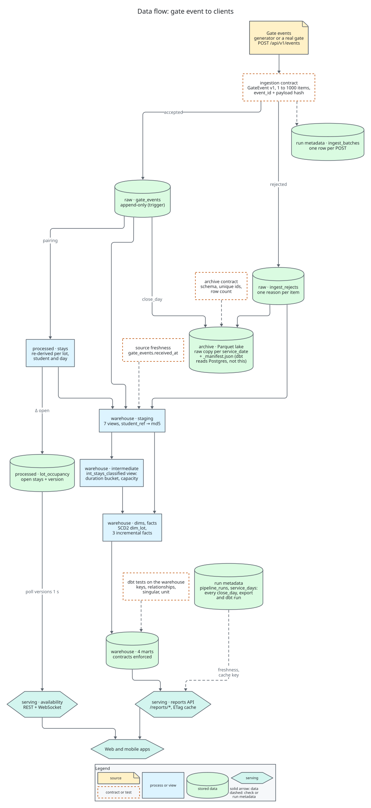
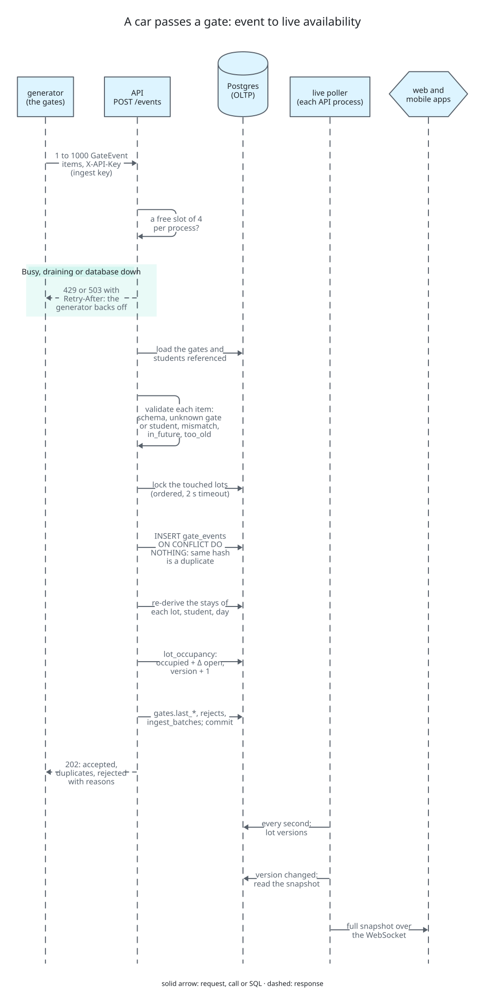
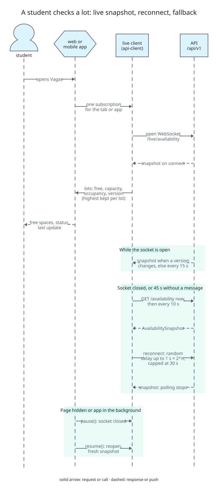
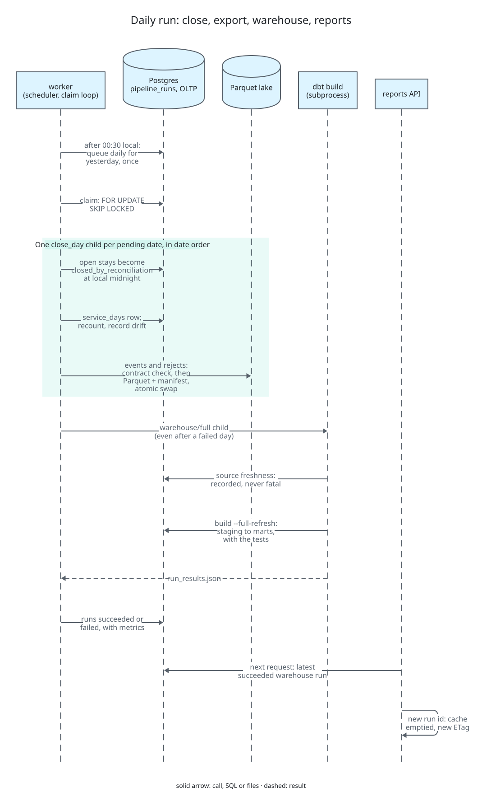

# End-to-end flow

The whole system in one ordered sequence: from a car passing a gate to the number a student sees,
then the nightly batch that turns the day into reports. The events come from the turnstile
generator, which simulates the campus gates. The diagrams draw the same steps; their D2 sources
are in [diagrams/](diagrams/). Click a diagram to open it at full size.

## 0. Setup

1. `migrate` applies the Alembic migrations (schema `public`).
2. The generator's `bootstrap` creates the registry through the admin endpoints (admin key):
   two lots with their capacity history, four gates (an entry and an exit per lot) and 10,000
   pseudonymous students. Every call is an idempotent upsert.

## 1. A car passes a gate

3. A gate (here the generator, which stands in for the face-ID turnstiles) sends
   `POST /api/v1/events` with 1 to 1000 `GateEvent` v1 items and the ingest key. Live mode
   flushes every few seconds; `backfill` sends past days in batches of 1000.
4. The API takes one of 4 ingest slots per process. With none free, or while draining, or with
   the database down, it answers 429 or 503 with `Retry-After` and the generator backs off.
5. It loads the gates and students the batch references and validates each item in order:
   schema, unknown gate, unknown student, lot mismatch, direction mismatch, more than 300 s in
   the future, more than 120 days old. A failing item becomes an `ingest_rejects` row with its
   reason; the batch goes on.
6. It locks the touched lots in `lot_id` order (2 s lock timeout, else 429) and inserts the
   accepted events into `gate_events` with `ON CONFLICT DO NOTHING`. An existing id with the same
   payload hash is a duplicate; with a different hash it is rejected `event_id_conflict`.
7. For every touched (lot, student, service day) it re-derives the stays from all their events
   (entry opens, exit closes, a second entry marks `missing_exit`, an exit alone is `exit_only`).
8. It adds the change in open stays to `lot_occupancy.occupied` and raises its `version`, updates
   `gates.last_event_at` and `last_received_at`, writes the `ingest_batches` row and commits.
9. The response is 202 with the counts of accepted, duplicate and rejected items and the reasons.

## 2. The student sees it

10. Each API process polls the lot versions every second. On a change, a lot appearing or
    disappearing, or every 15 s as a heartbeat, it reads the availability snapshot and sends it
    to every WebSocket client on `/api/v1/live/availability`.
11. The web or mobile app holds one subscription through the shared live client
    (`packages/api-client/src/live.ts`). It gets a snapshot on connect and keeps the highest
    version per lot, then shows free spaces, the capacity bar, the status (free, busy, full) and
    the last update.
12. If the socket closes, or 45 s pass without a message, the client polls
    `GET /api/v1/availability` every 10 s and reconnects with jittered backoff up to 30 s; the
    polling stops once the socket is open again. A hidden page or a backgrounded app closes the
    socket and reopens it, with a fresh snapshot, when it returns.

## 3. Every 15 minutes

13. The worker's scheduler queues `warehouse/incremental` when no warehouse run was requested in
    the last 15 minutes. The worker claims it, runs `dbt build` (staging views, the intermediate
    `int_stays_classified` view, the incremental facts, the marts and their tests) and records
    the result in `pipeline_runs`.

## 4. The daily run

14. After 00:30 local time the scheduler queues one `daily` run for yesterday. The worker claims
    it with `FOR UPDATE SKIP LOCKED`.
15. `daily` starts one `close_day` child per pending date, in date order: yesterday, past dates
    that were never closed and dates that received events after their export.
16. Each `close_day` locks the lots, sets that day's open stays to `closed_by_reconciliation` at
    local midnight, writes `service_days`, recounts the open stays per lot and records any drift.
17. It then exports the day's events and rejects to the Parquet lake
    (`raw/gate_events/service_date=.../`, `raw/ingest_rejects/received_date=.../`): each file
    passes the archive contract (schema, unique ids, row count against the source) and is
    published with a `_manifest.json` through an atomic directory swap. The lake is a raw copy;
    dbt reads Postgres, not these files.
18. The last child is `warehouse/full`, which runs even when a day failed: `dbt source
    freshness` (recorded in the run metrics, never fatal), then `dbt build --full-refresh`:
    staging views over the OLTP tables, the intermediate `int_stays_classified` view (duration
    bucket and the capacity in force on the stay's date), the dimensions and facts, the marts,
    and every test.
19. Every child and the parent end as `succeeded` or `failed` in `pipeline_runs`, with their row
    counts and metrics.

## 5. Reports

20. On the next request, the reports API looks up the latest succeeded warehouse run. A new run
    id empties its cache and changes the ETag; until then it answers from the cache or with 304.
21. The Relatórios pages read `/api/v1/reports/*` (summary, daily, hourly, weekday, occupancy,
    dwell, quality, freshness) and show the data's age from `/reports/freshness`. The operator
    page reads ingestion health, rejects and runs with the operator key.
